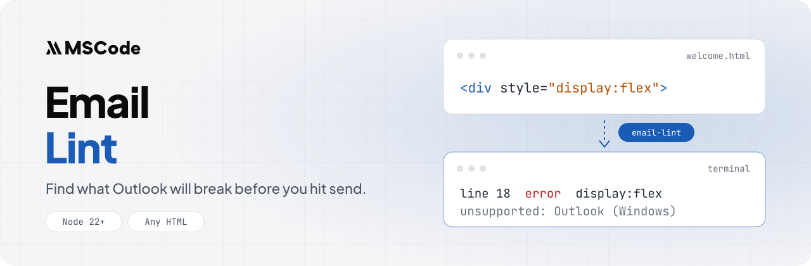
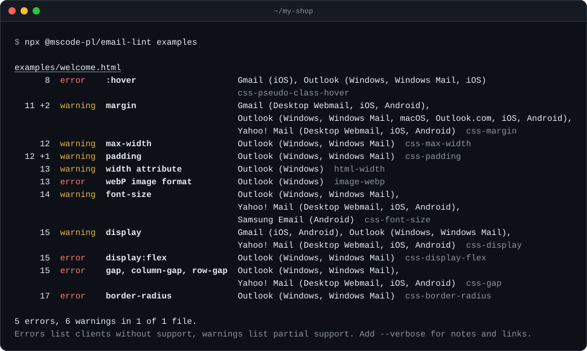

<p align="center">
  <picture>
    <source media="(prefers-color-scheme: dark)" srcset=".github/banner-dark.svg">
    
  </picture>
</p>

<p align="center">
  <a href="https://www.npmjs.com/package/@mscode-pl/email-lint"></a>
  <a href="https://www.npmjs.com/package/@mscode-pl/email-lint"></a>
  <a href="https://github.com/mscode-pl/email-lint/actions/workflows/ci.yml"></a>
  
  <a href="LICENSE"></a>
</p>

<p align="center">
  email-lint reads your email HTML and points at every CSS property, selector, HTML element and image format that Gmail, Outlook, Apple Mail, Yahoo and 18 other clients do not support, with the line it is on. The support data comes from <a href="https://www.caniemail.com">caniemail.com</a> and ships with the package, so it runs offline and in CI.
</p>

<p align="center">
  <a href="#try-it">Try it</a> · <a href="#works-with-your-stack">Stacks</a> · <a href="#use-it-in-ci">CI</a> · <a href="#options">Options</a> · <a href="#use-it-from-code">API</a> · <a href="#use-it-from-an-ai-agent">AI agents</a>
</p>

<p align="center">
  
</p>

## Try it

Run it with no arguments and it walks you through the check: it finds the HTML in your project, asks which clients matter, shows the results and can save a report.

```bash
npx @mscode-pl/email-lint
```

Or check a folder in one command:

```bash
npx @mscode-pl/email-lint emails/
```

It needs Node 22 or newer, no account and no API key, and it sends nothing over the network.

## Why

Email clients render a small and uneven slice of CSS. Outlook for Windows still uses Word to draw HTML, so `display: flex`, `border-radius` and `max-width` on a `<div>` quietly do nothing there. Gmail drops your `<style>` block for some accounts. The usual way to find out is a customer screenshot, or a paid rendering service on every change.

caniemail.com already tracks which client supports what. email-lint applies that table to your actual templates, so the answer is a list of lines to fix instead of 308 feature pages to read.

## What you get

| Feature | Details |
| --- | --- |
| **Line numbers for every problem** | In inline styles, `<style>` blocks and attributes alike. |
| **306 of 308 caniemail features** | CSS properties and values, selectors and pseudo-classes, at-rules and media features, units and functions, HTML elements and attributes, image formats. BIMI and HDR images cannot be seen in HTML. |
| **Errors that mean something** | An error is a feature at least one of your clients does not support at all. A warning is partial support, and `--verbose` prints caniemail's note on what is missing. |
| **Outlook conditionals understood** | Content inside `<!--[if !mso]><!-->` is hidden from Outlook for Windows, so it is not blamed for it. That is the hybrid layout most email frameworks generate. |
| **Low noise by default** | `<body>`, `<style>`, tables, class selectors, `role` and `aria-*` are not reported, because the only fix would be removing them. `--strict` shows everything. |
| **Reports you can share** | Markdown for a pull request, JSON for scripts, GitHub annotations on the pull request. |
| **GitHub Action and MCP server** | One pull request comment that updates itself, and two tools your AI agent can call while it writes the email. |

## Works with your stack

email-lint checks rendered HTML, so it works with any tool that produces it:

| Stack | Command |
| --- | --- |
| Plain HTML | `npx @mscode-pl/email-lint emails/` |
| React Email | `npx email export --outDir out && npx @mscode-pl/email-lint out/` |
| MJML | `npx mjml "emails/*.mjml" -o out/ && npx @mscode-pl/email-lint out/` |
| Maizzle | `npx maizzle build production`, then lint the output folder |
| [laravel-react-email](https://github.com/mscode-pl/laravel-react-email) | `php artisan react-email:build && npx @mscode-pl/email-lint "resources/views/react-email/**/*.blade.php"` |

Blade syntax such as `{{ $name }}` and `@if` is read as text and does not trigger false reports.

## Pick your clients

The default set is Gmail, Outlook, Apple Mail, Yahoo, Samsung Email and Thunderbird. Narrow it down to what your audience uses:

```bash
email-lint emails/ --clients gmail,apple-mail     # consumer newsletter
email-lint emails/ --clients outlook.windows      # one platform of one client
email-lint emails/ --clients all                  # every client caniemail tests
```

A typo fails with the list of valid names instead of silently checking nothing.

<details>
<summary>All 22 clients</summary>

`gmail`, `outlook`, `apple-mail`, `yahoo`, `samsung-email`, `thunderbird`, `protonmail`, `fastmail`, `hey`, `aol`, `wp-pl`, `gmx`, `web-de`, `t-online-de`, `orange`, `sfr`, `free-fr`, `laposte`, `mail-ru`, `ionos-1and1`, `rainloop`, `microsoft`

</details>

## Use it in CI

Commit a config file so everyone on the team runs the same check:

```json
{
  "files": ["emails/**/*.html"],
  "clients": ["gmail", "outlook", "apple-mail"],
  "ignore": ["css-border-radius"],
  "failOn": "error"
}
```

Save it as `email-lint.config.json`, and `email-lint` with no arguments uses it. The interactive mode can write it for you.

### GitHub Action

The action marks every finding on the line it is on in the pull request diff, and posts the full report as one comment that it updates on every push instead of adding a new one. When the issues are fixed, the comment says so.

```yaml
name: Emails

on: pull_request

permissions:
  contents: read
  pull-requests: write

jobs:
  email-lint:
    runs-on: ubuntu-latest
    steps:
      - uses: actions/checkout@v4
      # Build your templates first, e.g. npx email export --outDir out
      - uses: mscode-pl/email-lint@v1
        with:
          files: out
          clients: gmail,outlook,apple-mail
```

| Input | Default | |
| --- | --- | --- |
| `files` | `files` from the config | Files, folders or globs, separated by spaces or new lines |
| `clients` | config, then the defaults | Comma separated, e.g. `gmail,outlook.windows` |
| `ignore` | | Feature slugs to skip, comma separated |
| `strict` | `false` | Also report baseline features |
| `fail-on` | config, then `error` | `error`, `warning` or `never` |
| `config` | `email-lint.config.json` | Config file to read |
| `comment` | `true` | Post the report as a pull request comment |
| `github-token` | `github.token` | Token for the comment |
| `version` | the action's release | email-lint version from npm |

Outputs: `report` (path to the Markdown report, also shown in the job summary) and `exit-code`. The step needs Node 22; on an older runner the action installs it. Pull requests from forks get a read-only token, so they get the annotations and the job summary but no comment. GitHub shows at most 10 annotations of each level per step, and the comment lists the rest.

### Any other CI

`--format github` prints GitHub annotations, `-o report.md` saves a Markdown report:

```yaml
- run: npx @mscode-pl/email-lint --format github -o email-report.md
```

The exit code is `1` when there are errors (or warnings with `--fail-on warning`), `0` otherwise, and `2` for bad arguments or no matching files.

## Options

| Option | Default | |
| --- | --- | --- |
| `-c, --clients <list>` | see above | Clients to check |
| `-i, --ignore <list>` | | Feature slugs to skip, e.g. `css-display-flex` |
| `--strict` | off | Also report baseline features and Gmail in a mobile browser |
| `-f, --format <type>` | `text` | `text`, `json`, `markdown` or `github` |
| `-o, --output <file>` | | Also save a full report; `.json` and `.md` pick the format |
| `--verbose` / `-q, --quiet` | off | caniemail notes and links / errors only |
| `--fail-on <level>` | `error` | `error`, `warning` or `never` |
| `--config <file>` | `email-lint.config.json` | Config file to read |
| `--stdin` | | Read HTML from stdin |

## Use it from code

```ts
import { lint } from '@mscode-pl/email-lint';

const { issues, errors } = lint(html, { clients: ['gmail', 'outlook'] });

for (const issue of issues) {
  console.log(issue.lines, issue.level, issue.title, issue.clients);
}
```

`lint` is synchronous and does no I/O beyond reading the bundled dataset once. Every issue carries the caniemail slug, its URL, the affected lines and, per client and platform, the support status and notes.

## Use it from an AI agent

### MCP server

`email-lint mcp` starts an [MCP](https://modelcontextprotocol.io) server on stdio, so Claude, Cursor, VS Code and other MCP clients can check a template while they write it. It has two read-only tools:

| Tool | What it does |
| --- | --- |
| `lint_email` | Lints `html` passed inline or a `path` (file, folder or glob) and returns every issue with its line, the affected clients and caniemail's notes. With neither, it lints the files from `email-lint.config.json`. |
| `explain_feature` | For one slug, says which clients lack support, whether that breaks the email or only drops decoration, and how to fix it. |

Paths are relative to the folder the client starts the server in, usually your project, and `email-lint.config.json` there sets the default clients and ignored features.

Claude Code:

```bash
claude mcp add email-lint -- npx -y @mscode-pl/email-lint mcp
```

Cursor, VS Code, Claude Desktop and others take the same command in their MCP config:

```json
{
  "mcpServers": {
    "email-lint": {
      "command": "npx",
      "args": ["-y", "@mscode-pl/email-lint", "mcp"]
    }
  }
}
```

To lint a folder that is named `mcp`, write it as `./mcp`.

### Agent Skill

The repo ships an [Agent Skill](skills/email-lint/SKILL.md) for Claude Code, Codex, Cursor and other agents. It runs email-lint on your templates, sorts the findings into must-fix and acceptable degradation, and proposes fixes in your source files (a table instead of flexbox, VML for rounded Outlook buttons, PNG instead of WebP).

```bash
npx skills add mscode-pl/email-lint
```

## How support is judged

- Each client platform (Gmail on iOS, Outlook on Windows) is judged by the newest version caniemail tested.
- Gmail opened in a mobile browser is left out by default. It drops `<style>` entirely and would flag nearly every email; name it with `--clients gmail.mobile-webmail` to include it.
- email-lint reads markup, it does not render it. It tells you a feature is used where a client ignores it, not how the result looks. For pixel checks you still need a real client or a rendering service.

## Updating the data

The dataset in `data/caniemail.json` is a trimmed copy of caniemail's API, dated in `email-lint --version`. To refresh it:

```bash
pnpm update-data
```

## Contributing

```bash
pnpm install
pnpm test
pnpm build && node dist/cli/main.js examples
```

`pnpm screenshot` regenerates `docs/screenshot.svg` from the real CLI output.

## License

MIT. Support data from [caniemail](https://github.com/hteumeuleu/caniemail) by Rémi Parmentier, MIT License, see [data/LICENSE-caniemail](data/LICENSE-caniemail).

---

<p align="center">
  <a href="https://mscode.pl">
    <picture>
      <source media="(prefers-color-scheme: dark)" srcset=".github/mscode-logo-white.svg">
      
    </picture>
  </a>
</p>

<p align="center">
  Built and maintained by <a href="https://mscode.pl">MSCode</a>, a Polish software house that makes websites and web and mobile apps.
</p>

<p align="center">
  <a href="https://mscode.pl">mscode.pl</a> · <a href="https://github.com/mscode-pl">More packages</a> · <a href="https://github.com/mscode-pl/email-lint/issues">Report an issue</a>
</p>
